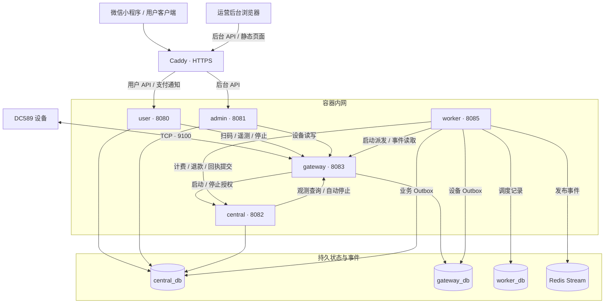
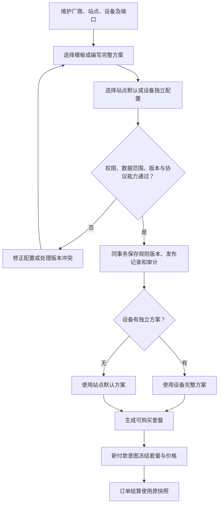
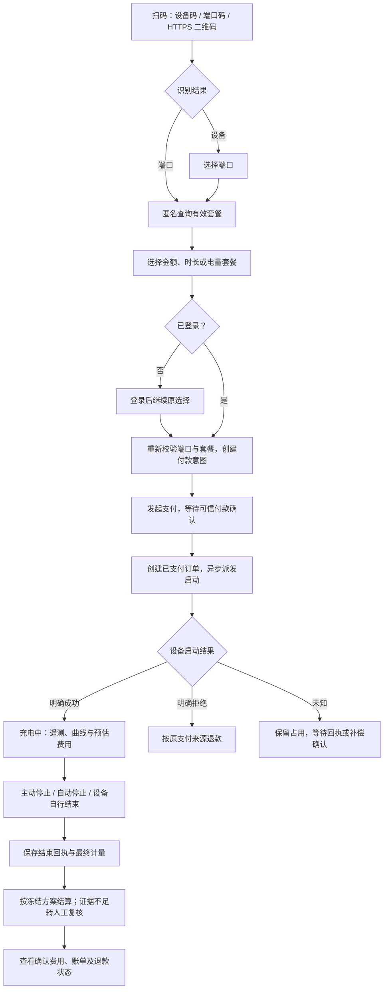
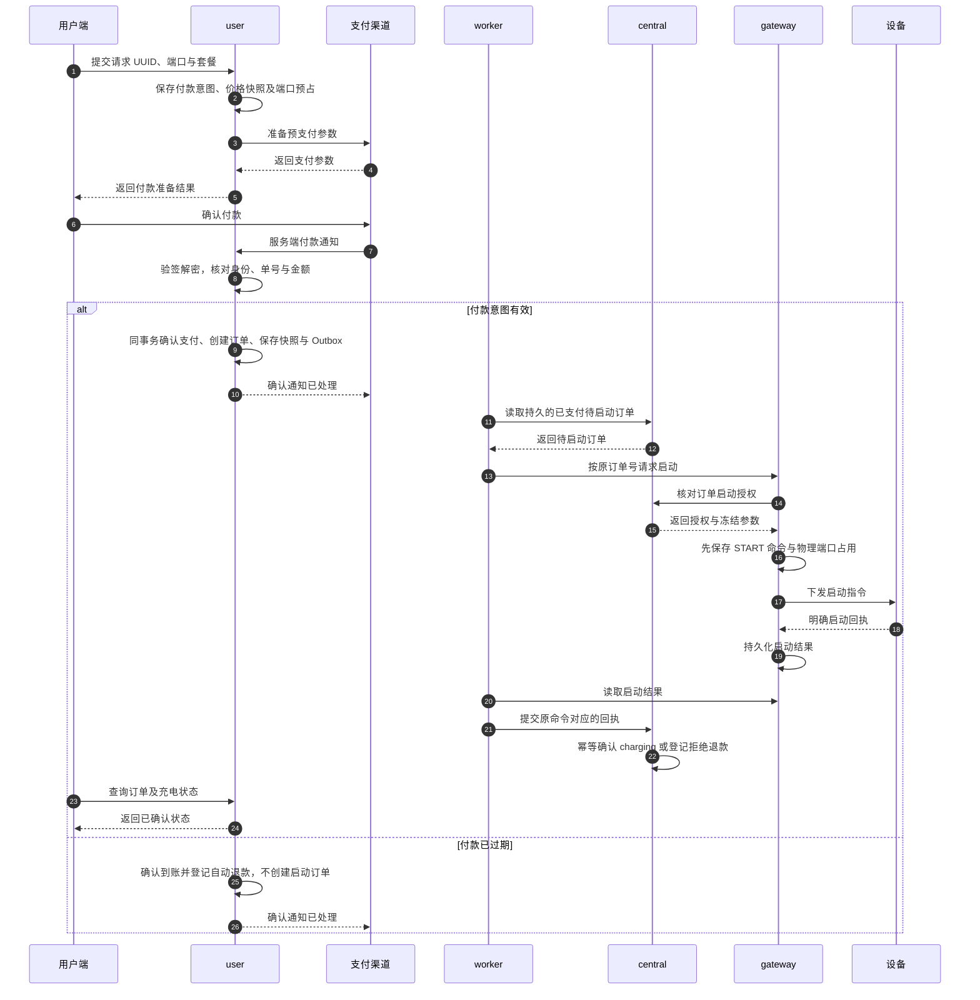
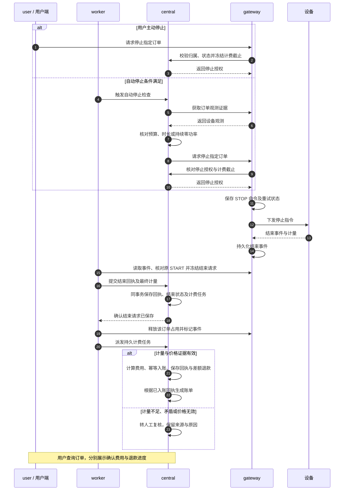
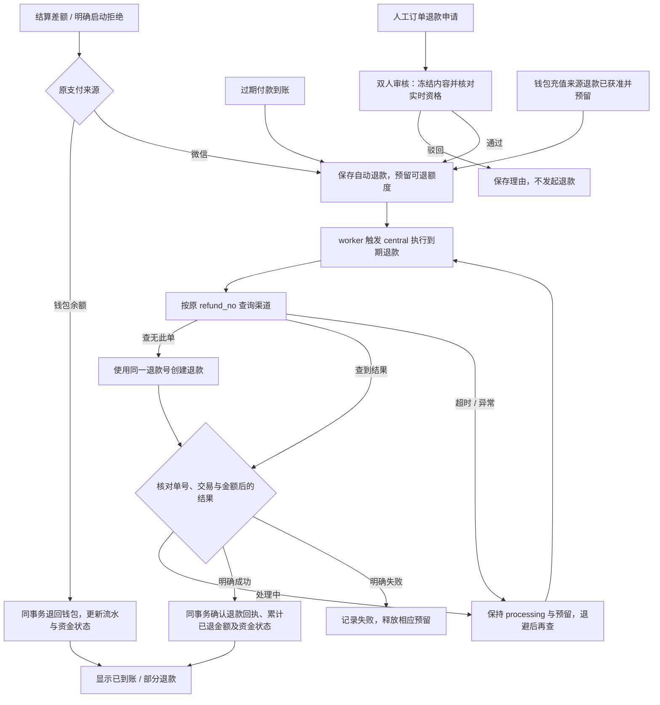
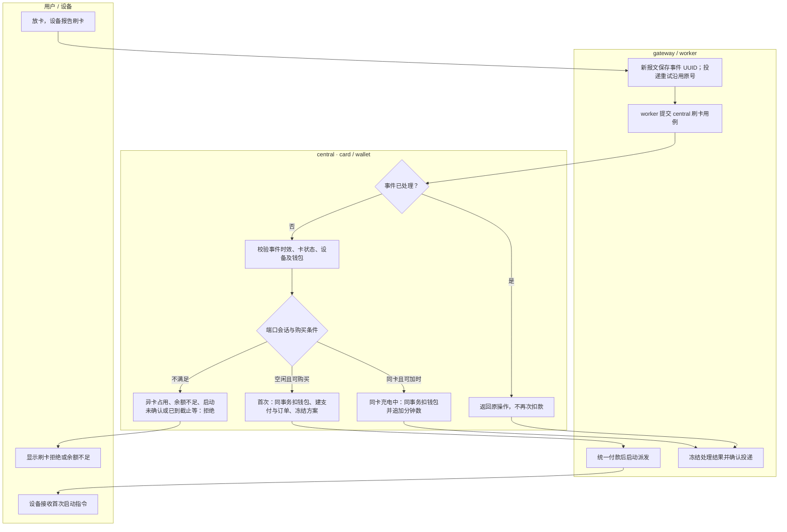
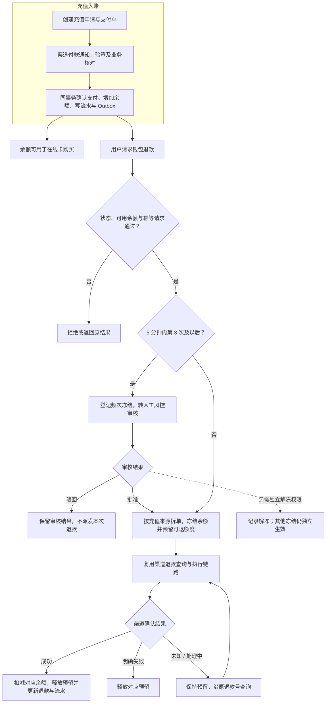
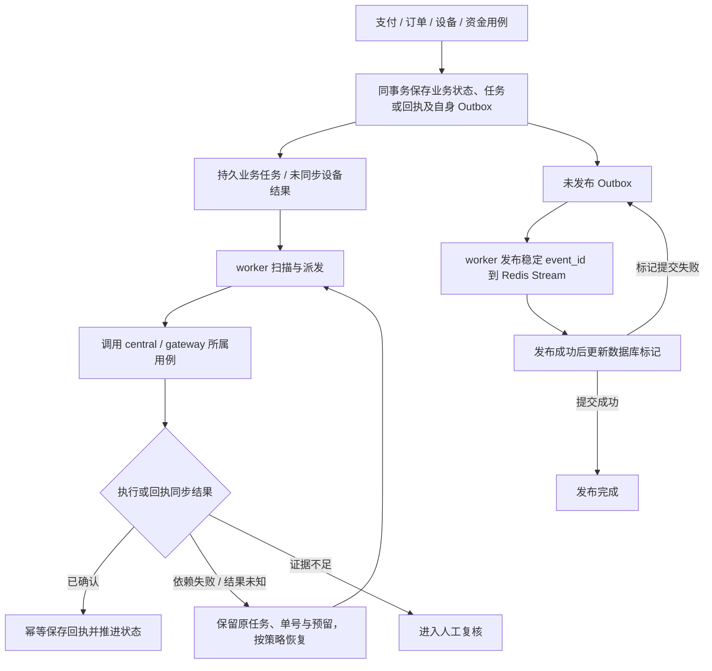

# ChargePilot

ChargePilot 是单客户独立部署的二轮车充电运营平台，支持扫码充电、钱包与在线卡、计费退款及运营管理。后端使用 Go，后台使用 React，用户端使用 Taro 构建 H5 和微信小程序，设备通过 DC589/TCP 接入。

## 功能概览

| 业务 | 当前能力 |
| --- | --- |
| 扫码充电 | 匿名识别设备与端口、查询套餐，支付前登录；付款确认后启动、查看遥测与预估费用、主动停止 |
| 方案与计费 | 站点默认方案、设备整体覆盖；金额、固定时长、固定电量套餐；下单冻结价格，按有效计量结算 |
| 在线卡 | 运营绑定、用户挂失与解绑；刷卡扣钱包、同卡重刷购买时长、未用差额退回钱包 |
| 钱包与退款 | 充值到账、余额与流水、原充值来源退款、频次风控、审核及独立解冻 |
| 设备与站点 | 厂商、站点、设备开通与运营状态；DC589 指令、心跳、采样、历史曲线和故障记录 |
| 运营与财务 | 订单与账单、计量复核、人工退款双人审核、发票申请审核、公告、优惠券及数据导出 |
| 异步恢复 | 持久启动任务、设备结果同步、自动停止、计费与退款派发、Outbox 发布及幂等回执 |

这些能力按当前代码归纳；真实支付、实机与外部平台的接入边界见[当前边界](#当前边界)。

阅读入口：[本地运行](#本地运行) · [服务与代码](#服务与代码) · [核心业务流程](#核心业务流程) · [接口与业务约定](#接口与业务约定) · [开发与验证](#开发与验证) · [生产部署与维护](#生产部署与维护)。

## 仓库结构

- `backend/`：后端 Go 模块 `chargepilot`（`cmd/`、`internal/`、`migrations/`、`go.mod`），服务镜像定义为 `backend/Dockerfile`，构建上下文即该目录。后端路径约定见 [AGENTS.md](AGENTS.md)。
- `frontend/admin-web/`、`frontend/miniprogram/`：运营后台与用户端前端。
- `docker/`：Compose 编排（`compose.dev.yaml`、`compose.prod.yaml`）、生产 Caddyfile 与 MySQL 初始化 SQL。
- 仓库根：`scripts/`（跨平台 Node 脚本）、`docs/` 与根 `tasks.mjs`。

## 本地运行

需要 Docker Desktop（或 Docker Engine）、Compose v2 及 Node.js 24。脚本均为跨平台 Node 脚本，以下命令在任意系统均从仓库根目录直接执行：

```sh
node scripts/dev/start.mjs
# 等待服务就绪后准备厂商、站点、两台设备和测试方案
node scripts/dev/prepare.mjs
```

也可直接使用 `docker compose -f docker/compose.dev.yaml up -d`。首次启动会安装前端依赖、编译后端并初始化空库；启动和数据准备均保留已有数据及配置。

| 入口 | 本地地址 |
| --- | --- |
| 运营后台 | http://127.0.0.1:5173/admin/ |
| 用户 H5 | http://127.0.0.1:5174/ |
| user / admin API | `127.0.0.1:8080` / `8081` |
| gateway / worker HTTP | `127.0.0.1:8083` / `8085` |
| DC589/TCP | `127.0.0.1:9100` |
| MySQL | `127.0.0.1:3306` |
| Redis Cache / Stream | `127.0.0.1:6379` / `6380` |

开发后台默认账号为 `admin / ChangeMe!Admin2026`，H5 测试账号为 `tester-1`。后台引导只在账号表为空时执行。准备脚本读取当前进程的 `ADMIN_BOOTSTRAP_USER`、`ADMIN_BOOTSTRAP_PASSWORD`，不自动加载 `.env`；已有账号改密后须传入有效凭证。

开发栈使用开发登录和模拟支付，模拟支付仍走订单、设备、结算和退款流程。Go 服务没有热重载；修改源码后重建对应进程，例如：

```sh
docker compose -f docker/compose.dev.yaml up -d --no-deps --force-recreate user admin central gateway worker
```

修改用户端 `app.config.ts` 后，须重启 `user-h5` 容器才能重建路由表：`docker compose -f docker/compose.dev.yaml restart user-h5`。

### 模拟器

准备设备后，在两个终端分别执行：

```sh
node scripts/dev/simulator.mjs --number 1
node scripts/dev/simulator.mjs --number 2
```

两个实例对应设备 `5348240514082652`、`5348240514082653`，控制端口为 `9190`、`9191`，状态保存在各自的 `.tmp/` 文件。模拟器只连接已开通设备；端口数须与后台一致。

联调顺序：确认设备在线 → 用户选择端口和套餐 → 模拟付款 → 调整功率或刷卡 → 停止充电 → 核对计量、账单、退款及钱包流水。TUI 用 `m` 打开菜单、`Tab` 切页、`q` 退出；无界面控制和重启恢复说明见 [模拟器操作](docs/operations.md#模拟器操作)。

## 服务与代码

| 进程 | 职责 | 数据库 | HTTP |
| --- | --- | --- | --- |
| `user` | 用户登录、扫码、订单、支付、钱包与卡券 | `central_db` | `8080` |
| `admin` | 站点、设备、订单、资金、审计与导出 | `central_db` | `8081` |
| `central` | 内部用例编排、授权、回执、计费与退款 | `central_db` | `8082` |
| `gateway` | TCP 接入、设备指令、遥测与端口占用 | `gateway_db` | `8083` |
| `worker` | 持久任务扫描、结果同步与 Outbox 发布 | 三库；执行状态在 `worker_db` | `8085` |

central 的 `8082` 在开发和生产编排中都不映射到宿主机，只能从容器网络访问。生产 HTTP 经 Caddy 分流至 user/admin，gateway/worker HTTP 仅内网可达；设备另走 `9100/TCP`。五个服务均提供 `/health/live`、`/health/ready` 和 `/metrics`。

业务按 `backend/internal/` 下十二个 use case 组织；`backend/cmd/` 负责装配与生命周期，`backend/internal/http/` 负责 HTTP 适配，`backend/internal/domain/` 保存纯规则。服务间 DTO 在 `contracts/`，具名客户端在 `integration/`；请求以 `Request` 结尾，响应以 `Reply` 结尾。完整职责和维护规则见 [AGENTS.md](AGENTS.md) 与 [架构边界](docs/architecture-boundaries.md)。

下面展示生产环境的主要调用与存储关系。三库是同一 MySQL 实例中的独立 schema；内部 HTTP 调用携服务令牌。五个进程复用同一套用例包，user/admin 在本进程执行所属用例并访问 `central_db`。



## 核心业务流程

以下 Mermaid 图可在支持 Mermaid 的 Markdown 阅读器中渲染，描述当前已装配的业务链路。流程图展示条件分支，泳道图和时序图展示责任归属；图中的受理、确认、结算和到账各有独立证据。具体计量、金额、权限及重试条件以[业务与接口契约](docs/business-contracts.md)为准。

### 1. 运营准备与方案发布

运营人员先开通设备和端口，再发布兼容该协议的方案。模板应用时复制配置；设备独立方案整体覆盖站点默认方案，撤销覆盖后恢复继承。发布新版本只影响后续购买，历史订单继续使用冻结快照。



实现入口：[方案发布](backend/internal/pricing/publication.go)、[扫码支付准备](backend/internal/payment/checkout.go)。发布方案不下发充电指令；设备禁用阻止新购买和加时，已有订单仍可停止、结算及退款。

### 2. 用户扫码到完成

用户可匿名扫码、选端口及浏览套餐，支付前才要求登录。设备码进入端口选择，端口码直接定位插口；金额和套餐由服务端确定。



支付取消、失败或尚未确认时不启动设备；付款意图过期后收到付款则登记退款。启动结果未知时不会直接认定失败或再次发送新的启动指令。实时费用是预估值，最终费用来自有效结算回执。

### 3. 支付确认与设备启动时序

此图以微信支付的正常路径为例；开发模拟支付复用业务回调逻辑。`scan/start` 的响应是付款准备结果，客户端支付成功仍须等待服务端确认。



实现入口：[付款回调](backend/internal/payment/payment_callback_repo.go)、[付款后启动派发](backend/internal/worker/charge/paid_start.go)、[网关启动](backend/internal/gateway/control/start.go)、[启动结果](backend/internal/charging/start/result_repo.go)。启动受理及 TCP 写入成功均不代表设备已开始充电。

### 4. 停止、结束同步与计费

用户停止经 user 调用 gateway；自动停止由 worker 触发 central 判断，再请求 gateway。预算、时长或主动停止首次确定计费截止点，迟到的物理停机不增加截止点之后的费用。设备也可自行结束并上报。



实现入口：[自动停止](backend/internal/charging/stop/auto_stop.go)、[结束同步](backend/internal/worker/charge/end_sync.go)、[计费调度](backend/internal/settlement/billing.go)。持续零功率须至少 1 分钟且最新观测在 30 秒内，离线和缺失读数不作为停止证据。结束同步失败保留事件与占用；账单生成失败由补发任务恢复，已确认费用不重复入账。

### 5. 差额退款与人工退款

未用差额按原支付来源返还：在线卡余额付款退回钱包，微信付款走渠道退款。人工订单退款限定已结束的微信付款订单，申请后须双人审核；审核通过后才进入自动执行。钱包充值退款也复用渠道执行链路。



实现入口：[结算资金入账](backend/internal/settlement/billing_job_repo.go)、[余额退款](backend/internal/settlement/balance_refund_repo.go)、[人工审核](backend/internal/settlement/refund_review_repo.go)、[渠道退款执行](backend/internal/settlement/refund_executor_repo.go)。在途预留和已成功退款共同占用可退额度；请求受理、审核通过、`processing` 均不表示款项已退。渠道创建请求超时也进入未知结果恢复，继续查询同一退款号。

### 6. 在线卡刷卡与加时泳道

在线卡绑定用户钱包，购买方案中的时长套餐。首次刷卡生成已支付订单并走统一启动链路；同卡在充电中重刷沿用原快照追加付款和分钟数，整次加时受保护上限约束。



实现入口：[刷卡投递](backend/internal/worker/charge/cards.go)、[刷卡用例](backend/internal/card/swipe.go)、[加时判断](backend/internal/card/extension.go)。新事件超过 30 秒不再扣款，已处理事件可重放原结果。加时不下发新的 B7；原生报文无事件序号，实机须保证一次放卡只上报一次，移开重刷才产生新事件。

### 7. 钱包充值与原路退款

充值由服务端可信付款回调入账；钱包退款按原充值支付单拆分，并同时预留钱包可用余额与各支付单可退额度。审核和解冻是独立操作。



实现入口：[充值回调入账](backend/internal/payment/payment_callback_repo.go)、[钱包退款](backend/internal/wallet/refund.go)、[风控审核与解冻](backend/internal/wallet/risk.go)。可用余额为 `balance_cents - frozen_cents`；风控审核批准不自动解除钱包冻结，解除一项冻结不自动解除其他冻结。

### 8. 持久任务、Outbox 与故障恢复

数据库任务推进核心业务，Outbox 负责发布已提交的事实。付款后启动、设备结束、计费与退款不依赖 Redis 通知流推进；worker 调用所属用例，不复制计费算法或资金逻辑。



实现入口：[worker 装配](backend/cmd/worker/app.go)、[轮询运行时](backend/internal/worker/runtime/runtime.go)、[Outbox 发布器](backend/internal/worker/outbox/publisher.go)。每秒同步刷卡、待启动、启动及结束结果并发布 Outbox；每 10 秒依次触发自动停止、计费及退款。Redis 已写入但发布标记未提交时可能重复发布，事件处理须按稳定 ID 去重。当前调度器处理器表为空，Webhook、通用 DLQ 和监管投递未装配；任务周期、Stream 用途与恢复边界见[异步任务](docs/business-contracts.md#异步任务)。

## 接口与业务约定

- 后台接口文档：`GET /api/docs/admin.openapi.json`，源文件为 [admin.openapi.json](backend/internal/http/auth/admin.openapi.json)。该文档端点未由生产 Caddy 对外代理。
- 用户接口文档：[user.openapi.json](backend/internal/http/user/user.openapi.json)，目前是静态契约文件。两份 OpenAPI 随接口变更维护，测试核对文档中的路由是否注册；实际路由见 [user](backend/cmd/user/routes.go)、[admin](backend/cmd/admin/routes.go)、[central](backend/cmd/central/routes.go)。
- 普通 JSON 响应的字段构成与 `code=0` 约定见[业务与接口契约](docs/business-contracts.md#接口与权限)；微信通知、文件、指标和 OpenAPI 使用各自格式。用户与后台会话分开，内部接口使用 `X-Service-Token`。
- 金额使用整数分；用户 Snowflake ID 为十进制字符串，前端须保留精度。数据库时间按 UTC，计费日界及 DC589 本地时间按北京时间。
- 下单冻结方案与价格；启动受理、设备启动、充电结束、结算及退款到账分别确认。未知设备结果保留占用，渠道结果未知复用原退款号查询。

计价、钱包、卡、审核、权限和异步恢复的完整规则见 [业务与接口契约](docs/business-contracts.md)；设备报文见 [DC589 协议](docs/protocols/dc589.md)。

## 开发与验证

宿主机需要 Go 1.27、Node.js 24 和 npm。开发 Compose 提供运行环境；后端检查与构建：

```sh
node scripts/git/install-hooks.mjs
node tasks.mjs check
node tasks.mjs build-all
# 直连开发环境（3306/6379），迁移三库并执行集成测试
node scripts/db/test-integration.mjs
```

`node tasks.mjs check` 顺序运行 `go fmt ./...`、`go vet ./...` 和 `go test ./...`（go 命令由 tasks.mjs 进入 `backend/` 执行）；pre-commit 直接运行 vet 和默认测试（经 scripts/git/pre-commit.mjs，不依赖 Make）。任务路径以入口文件定位，可从任意工作目录调用其绝对路径；`node tasks.mjs --help` 查看全部任务。编译产物在 `bin/`，可用 `node tasks.mjs build central` 单独构建。

任务入口覆盖 `fmt`、`lint`、`test`、`test-integration`、`build`、`build-all`、`check`、`clean`、`dev-up` 和 `dev-down`。`clean` 只清理 `bin/`，`dev-down` 停止开发容器并保留数据卷。任务编排与跨平台路径测试使用 `node --test scripts/tasks.test.mjs`。

真库测试由 `integration` tag 隔离，不包含在 `node tasks.mjs check` 中。按 2026-10-06 的决定，集成测试直接使用开发环境（3306/6379/6380）：`node scripts/db/test-integration.mjs` 会起依赖服务、补 [锁观测只读授权](docker/mysql/test-lock-observer.sql)、迁移三库并注入连接串。注意集成测试的显式主键会抬高开发库自增序号，必要时用 reset-dev 重建；直接执行 `node tasks.mjs test-integration` 须自行配置 `TEST_MYSQL_URL` 和 `TEST_REDIS_URL`。

前端命令在对应目录执行：

| 目录 | 安装 / 开发 | 检查 / 构建 |
| --- | --- | --- |
| `frontend/admin-web` | `npm ci`、`npm run dev` | `npm test`、`npm run lint`、`npm run build` |
| `frontend/miniprogram` | `npm ci`、`npm run dev:h5` 或 `npm run dev:weapp` | `npm run typecheck`、`npm test`、`npm run build:h5`、`npm run build:weapp` |

产物为 `frontend/admin-web/dist`、`frontend/miniprogram/dist/h5` 和 `frontend/miniprogram/dist/weapp`。微信开发工具导入 `dist/weapp` 并配置真实 AppID。CI workflow 已于 2026-10-06 移除：提交前在本地执行 `node tasks.mjs check`（pre-commit 钩子含 vet 与默认测试）与 `node scripts/db/test-integration.mjs`，用户端检查需单独执行。用户端后续开发与交互优化计划见 [miniprogram-roadmap.md](docs/miniprogram-roadmap.md)。

## 生产部署与维护

生产入口为 [compose.prod.yaml](docker/compose.prod.yaml)。复制 [.env.example](.env.example) 为 `.env`，填写实际凭据和域名，先构建后台静态文件，再检查并启动：

```sh
npm --prefix frontend/admin-web ci
npm --prefix frontend/admin-web run build
node scripts/ops/check-deploy.mjs
docker compose -f docker/compose.prod.yaml up -d --build
```

默认支付模式为 `disabled`。微信直连需要有效商户参数，并在 user 和 central 容器中只读挂载私钥；仅设置路径变量不会创建文件。生产配置、支付挂载、监控及故障定位见 [运行与数据维护](docs/operations.md)。

三库由 Goose 初始化，定义见 [central](backend/migrations/central_db/0001_init.sql)、[gateway](backend/migrations/gateway_db/0001_init.sql)、[worker](backend/migrations/worker_db/0001_init.sql)。已执行的初始化 SQL 修改后不会自动重跑；保留数据时先备份再做兼容更新。开发重建会清空三库及项目 Redis，操作条件见 [数据库维护](docs/operations.md#数据库)。备份恢复说明见 [运行与数据维护](docs/operations.md#备份与恢复)，恢复前须核对归档和目标环境。

## 当前边界

- 本地模拟链路不能代替真实微信商户、实机或外部平台验收。H5 支持开发登录和模拟支付；正式微信支付与手机号授权通过微信小程序。
- 内部 Outbox 和 Redis 发布已运行；Webhook、通用 DLQ、监管投递及其管理端点尚未装配。`REGULATORY_*` 是预留变量，修改值不会启用任务。
- 微信订阅消息、电子发票签发、汇付天下、自动银行出款、自动渠道账单下载、MQTT、OTA、月卡/年卡及混合支付未接入。多主体分账、提现与对账已移除。
- 公告列表只返回全局公告；站点详情另包含本站生效公告，城市定向尚未接线。

重构进度与后续验收见 [refactor-roadmap.md](docs/refactor-roadmap.md#9-进度与交付记录)。商业授权以签订合同为准。
