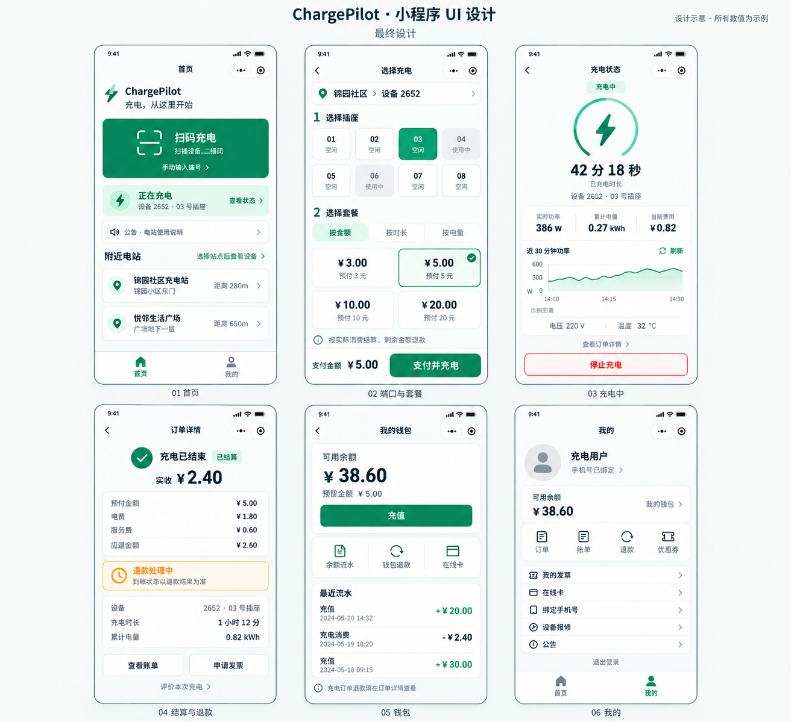
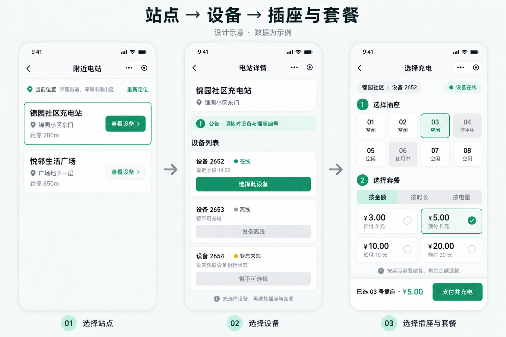

# WattHarbor 小程序最终 UI 设计

确认日期：2026-10-08。采用浅色背景、清晰状态和大按钮，覆盖现有 23 个页面。找站路径遵循“站点 → 设备列表 → 插座 → 套餐”，套餐使用“按金额 / 按时长 / 按电量”三个 Tab。本文件是最终设计交付，页面源码已按本设计实施；当前验证结果和微信端待验收项见用户端路线图第 6 节。

业务规则沿用 [业务与接口契约](../business-contracts.md)，开发状态沿用 [用户端路线图](../miniprogram-roadmap.md)。本文件规定展示与交互，不修改计费、资金或接口规则。

## 最终效果图

效果图使用 imagegen 内置工具生成。站点、设备、套餐档位、时间、金额和遥测均为示例；图片局部文案以本文件及业务契约为准。实施时从服务端读取数据，不把示例档位写成业务配置。

## 视觉规范

| 项目 | 规范 |
| --- | --- |
| 主色 | `#168665`，用于主要按钮与选中态 |
| 背景 | 页面 `#F5F7F6`；卡片白色；选中背景 `#E7F5EF` |
| 文字 | 主文字 `#182823`；辅助文字 `#718078` |
| 状态 | 绿色表示确认的正常状态，橙色表示处理中或待核实，红色表示失败或停止；同时显示文字 |
| 字体 | 正文 16px，辅助文字 12–14px，标题 20–24px，主金额与关键数据 32–36px |
| 间距 | 页面边距 16px；区块间距 16–24px；卡片内边距 16px |
| 圆角 | 卡片 16px，按钮 12px，标签 6px |
| 操作 | 主按钮高度至少 48px；常用点击区域至少 44px；每个区域突出一个主操作 |
| 图标 | 统一线性图标，不用 emoji 代替服务图标 |

尺寸为逻辑像素，小程序按 750 设计宽度换算 rpx。卡片使用轻边框，避免重阴影和无业务用途的插画。长编号可以换行，但插座编号须完整、易核对。

## 导航与充电流程

底部仅有“首页 / 我的”，仅在这两个一级页面展示。扫码是首页的大按钮；次级页使用返回导航，过程页底部放当前操作并预留安全区。

找站流程：选择站点 → 站点详情与设备列表 → 选择具体设备 → 选择可用插座 → 选择模式与套餐 → 支付 → 启动确认 → 充电状态 → 结束、结算与退款。

扫码识别设备码时进入设备的插座选择；识别插座码时定位对应插座，仍须核对可用状态。二维码归属以服务端解析为准。匿名用户可扫码并浏览，支付前才要求登录；登录成功保留原选择。

页面源码已实现“首页 / 我的”两项底部导航，站点详情展示设备列表，点击设备进入插座与套餐选择。执行结果与未覆盖项以用户端路线图中的验证记录为准。

## 套餐 Tab

| Tab | 卡片内容 | 结算说明 |
| --- | --- | --- |
| 按金额 | 套餐名、预付金额 | 按实际消费结算，展示最长充电限制及剩余退款规则 |
| 按时长 | 套餐名、购买时长、支付价格 | 提前结束按设备确认的完整分钟消费，沿用冻结规则 |
| 按电量 | 套餐名、购买电量、支付价格 | 提前结束按实际电量及冻结单价结算 |

- 先选插座，再加载该插座的可用套餐；只显示当前模式的套餐。
- 初始展示首个有套餐的模式，顺序为金额、时长、电量；套餐由用户明确选择。
- 使用两列套餐卡片；长名称允许纵向扩展，所选套餐规则在下方展示。
- 切换 Tab 后清除旧套餐；未选择新套餐时金额显示“请选择套餐”，支付按钮禁用。
- 切换插座时清除旧套餐和价格并重新加载，不沿用前一插座的 offer。
- 无套餐的模式保留 Tab，显示“暂无可用套餐”，提示切换模式。
- 底部固定显示插座、支付金额及“支付并充电”；内容预留底栏高度。
- 支付或启动操作发起后锁定插座、模式和套餐，沿用原恢复与幂等逻辑。
- 价格、时长、电量、满充停止能力、费用拆分和退款规则来自实际契约；不展示下单用券或任意输入充电金额。

## 全部页面规格

路径相对 `frontend/miniprogram/src/`，页面注册仍只维护 `app.config.ts`。

| 页面 | 路径 | 布局与操作 |
| --- | --- | --- |
| 首页 | `pages/index/index` | 扫码与手动输码、进行中订单、公告、附近站点；站点进入设备列表。无订单或公告时收起；移除常用站点占位和重复地图入口 |
| 扫码 | `pages/scan/scan` | 扫码主按钮、编号输入；相机拒绝时保留手动输入，取消不显示失败；H5 说明降级方式 |
| 插座与套餐 | `pages/scan-result/scan-result` | 设备归属与状态、编号网格、模式 Tab、套餐卡片、固定支付栏；明确插座使用中、不可用及未知状态 |
| 充电状态 | `pages/charge/charging` | 状态、时长、设备插座、功率电量费用、电压温度、曲线、规则与详情、停止按钮；圆形图案不表示电池百分比 |
| 订单历史 | `pages/charge/history` | 状态分段筛选、订单卡片、时间金额、触底加载；筛选沿用实际查询契约 |
| 订单详情 | `pages/charge/detail` | 充电、结算、退款分别展示；预付与实收及费用拆分；按状态显示补付、账单、发票和评价入口 |
| 附近电站 | `pages/stations/nearby` | 地图与列表、站名地址距离；H5 按能力降级，手动经纬度收进定位失败展开区 |
| 电站详情 | `pages/stations/detail` | 地址公告、设备列表；卡片显示编号、在线状态、最近上报；选择设备后进入其插座页面，未知状态不当作离线 |
| 钱包 | `pages/wallet/wallet` | 可用余额、冻结金额、充值主按钮、流水退款在线卡；近期流水需复用现有流水查询，冻结金额不统一改称退款预留 |
| 钱包充值 | `pages/wallet/recharge` | 快捷金额与自定义金额、金额校验；挂起支付优先展示查询与恢复入口 |
| 钱包退款 | `pages/wallet/refund` | 金额原因、原路退款提示、申请与子退款进度；结果未知时核实同一申请 |
| 余额流水 | `pages/wallet/txns` | 业务类别、金额方向、时间、关联信息；按实际接口支持全部 / 收入 / 支出筛选，触底加载与结束提示 |
| 在线卡 | `pages/wallet/cards` | 卡标识、状态、挂失解绑；操作前解释影响并确认，不增加卡发售能力 |
| 账单列表 | `pages/bills/list` | 金额、出账时间、未读标签与分页；列表不标记已读 |
| 账单详情 | `pages/bills/detail` | 编号、明细与时间；已读回执失败不撤销已展示内容，提供轻提示和重试 |
| 我的优惠券 | `pages/coupons/my` | 状态、有效期、适用说明与可用券查询入口；不承诺已支持下单抵扣 |
| 可用券查询 | `pages/coupons/available` | 只读券列表；不增加领取按钮、不推算接口未返回的优惠金额 |
| 发票申请 | `pages/invoice/apply` | 订单选择、现有发票字段、校验与申请；选择前提示最近 100 笔订单范围 |
| 我的发票 | `pages/invoice/my` | 审核状态、金额、拒绝原因、文件操作与新申请；微信文件预览需实施，H5 保留可用降级 |
| 我的 | `pages/profile/profile` | 资料余额、订单账单退款优惠券快捷区、发票在线卡报修公告等服务；未登录不显示虚构零余额 |
| 手机号 | `pages/profile/phone` | 已绑定和未绑定分别显示；绑定解绑独立，微信授权按实际能力执行 |
| 公告 | `pages/announcement/list` | 标题时间正文；沿用现有结构，不增加未注册的详情页 |
| 设备报修 | `pages/dev/fault` | 设备编号、类型描述、提交结果、报修列表及处理记录；未指定设备先引导扫码识别 |

“我的”中的新增服务接线在前端实施时完成。钱包退款和充电订单退款分别命名；充电订单退款从对应订单查看，不复用钱包退款申请表。

## 状态与异常

| 场景 | 展示与操作 |
| --- | --- |
| 首次加载 | 加载提示或骨架，读取成功前不显示假数值 |
| 空列表 | 说明暂无对应业务数据；有后续路径时给一个入口 |
| 读取失败 | 页内错误卡与重试，不同时显示空态；可信旧内容可保留并说明更新失败 |
| 定位失败 | 保留站点浏览，无坐标说明按最新站点展示，不伪称距离排序或显示 0 米 |
| 未登录 | 公开浏览继续，账户页引导登录；支付前登录并保留选择 |
| 设备离线或未知 | 文字说明并禁用选择；设备在线仍须查询插座是否可用 |
| 支付取消 | 按现有恢复逻辑继续同一流程，不显示设备已启动 |
| 支付结果未知 | “支付结果确认中”，查询原操作，禁止重复创建 |
| 支付已确认 | “已支付，设备启动确认中”，按快照更新，不提前显示充电中 |
| 无遥测 | “暂无数据”，不以 0 代替缺失，不伪造曲线 |
| 停止已受理 | “停止请求已提交，等待设备确认”，受理不等于已停止 |
| 订单结束 | 停止状态轮询，未确认的结算退款继续显示处理中 |
| 人工核对 | “计量不足，待管理员核对”，不猜算实收退款 |
| 退款 | 待处理、处理中、待审核、待核实、已退款或拒绝以实际结果为准 |
| 钱包冻结 | 单独说明原因，不仅将金额置灰 |
| 提交中 | 禁用重复操作，错误靠近字段；结果未知沿用原操作标识 |

实时功率、电量、单位和费用拆分遵循服务端 `display`。结束、结算和退款是独立事实，费用未知显示“待结算”。曲线只绘制实际采样，缺失段留空；自动刷新实施时须复用受管理的页面生命周期，避免重叠请求。

## 实施边界与验收

不引入电池百分比、预计充满时间、下单用券、常用站点、微信订阅消息、银行转账等新业务。接线、可视化和导航调整须实施后验证，不因效果图出现而视为已完成。

实施后核对双端窄屏、长名称、多套餐、空态、定位失败、未登录、离线、支付中断、启动确认和退款核实。每项实施原位更新用户端路线图，执行其规定的检查、构建与浏览器验证；模拟支付与设备状态不能替代真实微信支付及设备验收。

设计目录仅保留本说明、核心页面总览和充电流程图，不保留中间版效果图。
